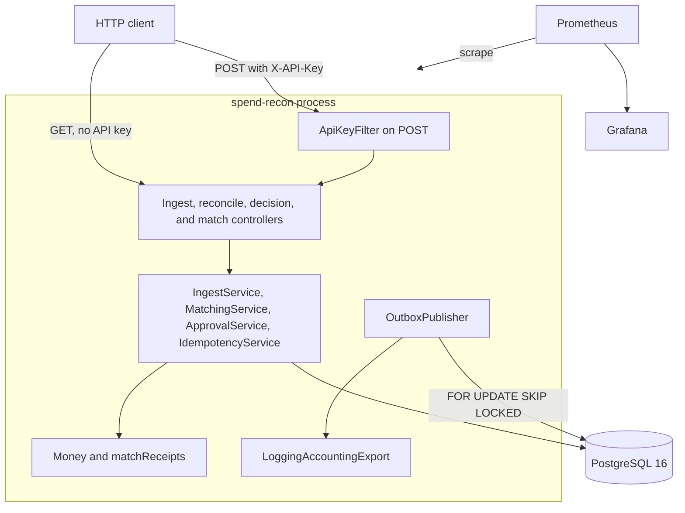
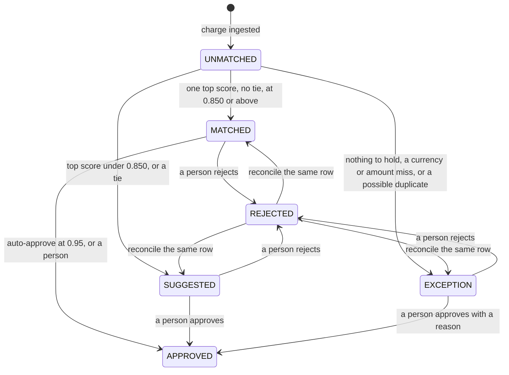

# spend-recon

A company card charge and a receipt are two records of the same spend, and they often do not line up. The name on the card is not the name on the receipt. The amounts differ. The receipt never arrives. Two receipts could fit one charge. Finance still has to say which charge is backed by which receipt, which ones a person must look at, and who made that call.

This service records the charge and the receipt, matches them with fixed rules, and keeps an audit row for every status change. A strong match is approved by the service. A weaker one waits for a person to approve or reject it. An approval also writes an outbox row, so an accounting export can be told later without making the approval wait on that export.

One charge moves like this:

1. `POST /transactions` records the charge. Its status is `UNMATCHED`.
2. `POST /documents` records the receipt (`kind` `RECEIPT`) or a bill. `documentNumber` is optional. The same merchant and the same receipt or invoice number return 409.
3. `POST /reconcile/{txnId}` matches the charge. The result is `MATCHED`, `SUGGESTED`, or `EXCEPTION`.
4. A `MATCHED` score of at least 0.95 is stored as `APPROVED` in that same request. Any other result waits. A person calls `POST /matches/{id}/approve` or `POST /matches/{id}/reject`.
5. Approve, by the service or by a person, inserts one `MatchConfirmed` row into `outbox` in the same database transaction. A poller publishes it.
6. Every transition appends one row to `reconciliation_events`. A trigger rejects `UPDATE` and `DELETE` on that table.

The locked design, including the rule table, is [docs/ARCHITECTURE.md](docs/ARCHITECTURE.md). This file is the short version of that design and the commands that exercise it.

## Quickstart

- JDK 21
- Docker, for `./gradlew build` and for Compose
- curl and jq, for the walkthrough and `scripts/seed.sh`
- k6, for `make load`

Kotlin 2.2.21, Spring Boot 3.5.16, Gradle Kotlin DSL, PostgreSQL 16, Flyway.

```bash
./gradlew build
docker compose up --build
```

`./gradlew build` starts a Postgres 16 container and runs the tests. `docker compose up --build` starts Postgres, the app, Prometheus, and Grafana.

- Health: http://localhost:8080/actuator/health
- Metrics: http://localhost:8080/actuator/prometheus
- API reference (Scalar): http://localhost:8080/scalar

Postgres is published on `localhost:5432` as database `spendrecon`, user `spendrecon`, password `spendrecon`. Those values are local defaults. Writes need `X-API-Key: local-dev-key` unless `RECON_API_KEY` is set.

## Kubernetes (kind)

Docker, kubectl, and kind 0.24.0 or newer are required. kind 0.24.0 is the first release whose default node image is Kubernetes 1.31, where nftables kube-proxy runs without a feature gate. `scripts/kind-config.yaml` selects that mode because a kernel without the `xt_statistic` match installs no iptables Service rules. `make kind-up` checks the kind version and stops if it is older.

`make kind-up` starts a Kubernetes cluster in Docker on this machine, builds the app image, and forwards the API to http://localhost:8080. Postgres 16 runs in that cluster. Flyway applies the migrations when the app process starts, the same way it does under Compose. Prometheus and Grafana stay on Compose.

The cluster name is `SPEND_RECON_KIND_CLUSTER`, default `spend-recon`. kind has its own cluster-name setting, `KIND_CLUSTER_NAME`. These scripts do not read it, so a value set for another project is left alone. After `make kind-up` creates a cluster, it labels the nodes `spend-recon.io/created-by=kind-up.sh`. It reuses a cluster only when that label is present. `make kind-down` deletes a cluster only when that label is present. Otherwise both scripts stop and explain why.

kubectl calls pass `--context kind-<cluster>` and `--kubeconfig .kube/kind-config`. They do not change the current context. `.kube/` is gitignored.

`make kind-down` deletes the cluster these scripts created.
The Postgres volume uses Retain. A deleted claim will not bind again, so recreate the data with `make kind-down && make kind-up`.
A cluster created before this change has no ownership label and is refused. Remove it once with `kind delete cluster --name spend-recon`.

The database password and `RECON_API_KEY` in `k8s/` are the same local defaults as Compose. They are not real credentials.

## Happy path

From the repository root, with Compose up and `jq` installed. The idempotency keys are fixed. The same keys and the same bodies replay the stored responses. Use new keys to insert new rows.

A charge and a receipt for the same cardholder, merchant, amount, currency, tax, and date score 1.000. That is `MATCHED`, and 1.000 is above the auto-approve threshold of 0.95, so the stored status is `APPROVED`.

```bash
base=http://127.0.0.1:8080
api_key=local-dev-key

charge=$(curl -fsS \
  -H 'Content-Type: application/json' \
  -H "X-API-Key: ${api_key}" \
  -H 'Idempotency-Key: walk-charge-1' \
  -d '{"cardOwnerId":"ada.ng","merchant":"Woolworths Metro","amount":"42.50","currency":"AUD","txnDate":"2026-11-20","tax":"3.86"}' \
  "${base}/transactions")
printf '%s\n' "${charge}"
charge_id=$(printf '%s' "${charge}" | jq -r '.id')

receipt=$(curl -fsS \
  -H 'Content-Type: application/json' \
  -H "X-API-Key: ${api_key}" \
  -H 'Idempotency-Key: walk-receipt-1' \
  -d '{"kind":"RECEIPT","cardOwnerId":"ada.ng","merchant":"Woolworths Metro","amount":"42.50","currency":"AUD","docDate":"2026-11-20","tax":"3.86"}' \
  "${base}/documents")
printf '%s\n' "${receipt}"

match=$(curl -fsS -X POST \
  -H "X-API-Key: ${api_key}" \
  -H 'Idempotency-Key: walk-reconcile-1' \
  "${base}/reconcile/${charge_id}")
printf '%s\n' "${match}"
match_id=$(printf '%s' "${match}" | jq -r '.matchId')

printf '%s\n' "$(curl -fsS "${base}/matches/${match_id}")"
printf '%s\n' "$(curl -fsS "${base}/matches/${match_id}/history")"

sleep 3
docker compose exec -T postgres \
  psql -U spendrecon -d spendrecon -c \
  "SELECT event_type, (published_at IS NOT NULL) AS published FROM outbox WHERE aggregate_id = '${match_id}';"
```

The charge response has `"status":"UNMATCHED"`. Reconcile returns `"status":"APPROVED"` and `"score":1.000`. `GET /matches/{id}` shows `decidedBy` `system:auto-approve` and `version` 0: the row is inserted already approved. History is two events, `MATCHED` by `system:matching`, then `APPROVED` by `system:auto-approve`. The outbox query returns `MatchConfirmed` with `published` true after the poller, which runs every second. There is no HTTP route for the outbox.

`GET /matches` and `GET /matches/{id}/history` do not check `X-API-Key`. These five `POST` routes do: `/transactions`, `/documents`, `/reconcile/{txnId}`, `/matches/{id}/approve`, and `/matches/{id}/reject`.

## Architecture

Hexagonal, and light. `domain` does not import Spring. The REST adapters call the application services. Those services write Postgres. The poller is the only publisher.



Compose runs all four boxes: the process, Postgres, Prometheus, and Grafana. `make kind-up` runs the process and Postgres only. `LoggingAccountingExport` logs the event and remembers the outbox id in this process. It is the stand-in for the accounting system.

## Match states

Score is `0.7 * merchant + 0.3 * tax`, rounded half up to three decimal places. Merchant is Jaro-Winkler on the normalized name. Tax is 1 when both sides have a tax and the minor units are equal, and 0 otherwise. Ingest stores the charge as `UNMATCHED`. That is the charge's status. A match row does not exist yet. The other names in the diagram are match statuses.

A single top score, with no tie, at 0.850 or above is `MATCHED`. Other receipts can exist. A lower top score is `SUGGESTED`. Two or more receipts tied for that top score are `SUGGESTED`, and the row holds the one with the lowest document id. Identical same-day receipts are not that tie: the same merchant, amount, currency, and date go to `EXCEPTION`, not `SUGGESTED`.



`POST /matches/{id}/approve` and `POST /matches/{id}/reject` send `version`, `actor`, and `reason`. `version` is the match's current version from `GET /matches/{id}`. Reject requires `reason`. Approve requires a non-empty `reason` only when the match is `EXCEPTION`. `MATCHED` and `SUGGESTED` can be approved with no reason.

Auto-approve does not leave the row sitting in `MATCHED`. The reconcile response status is `APPROVED`, `version` is 0, and the `MATCHED` step is the first history event. `SUGGESTED` and `EXCEPTION` are never auto-approved. A threshold above 1.0 turns auto-approve off. `APPROVED` is terminal. Reconciling it again returns 409. `REJECTED` is terminal for approve and reject, and reconcile is the only way back: it updates that same row.

The rules, the 3-day window, and the owner filter are in [docs/ARCHITECTURE.md](docs/ARCHITECTURE.md) section 6. A bill is stored and is not a candidate. Matching reads `kind = 'RECEIPT'`.

## Design trade-offs

Each one is a decision already in the code and in [docs/ARCHITECTURE.md](docs/ARCHITECTURE.md). The reason is the part to defend.

**Money is minor units plus a currency.** AUD 12.34 is stored as `1234` and `AUD`. JPY 500 is `500` and `JPY`. The scale comes from `java.util.Currency`. The API field is a decimal string. A JSON number is a 400, because a binary float cannot represent 0.10 exactly. Adding two amounts of different currencies throws. Postgres columns are `amount_minor BIGINT` and `currency CHAR(3)`. Section 3.

**Idempotency keys.** Every write sends `Idempotency-Key`. The key is unique with the endpoint, so the same token on `POST /transactions` and `POST /documents` is two keys. The service inserts the key with `ON CONFLICT DO NOTHING` in the same transaction as the business write. The same key and the same raw body return the stored response and increment `idempotent_replays_total`. The same key and a different body return 422. A key whose response is not stored yet returns 409 with `Retry-After`. A 400 does not consume the key. Section 7. `documentNumber` on `POST /documents` is optional. The same merchant and the same receipt or invoice number return 409 problem+json. That conflict is the duplicate number, separate from the in-flight idempotency 409.

**`matches.score` is nullable, with checks.** V1 created `score NOT NULL`. V2 drops that and adds two checks: `score` is null exactly when `document_id` is null, and a score is null or between 0 and 1. A match with no receipt has no score to invent. A match that holds a receipt always has one.

**An `EXCEPTION` holds its receipt, and a held receipt is skipped.** The partial unique index `matches_one_live_per_document` allows one non-`REJECTED` match per document. A currency or amount miss on a single close receipt becomes an `EXCEPTION` that points at that receipt, so a second charge cannot take it. If every remaining receipt is already held, the result is `NO_CANDIDATE`. Reject frees the receipt. Section 5.

**`NO_CANDIDATE`.** No receipt, or every receipt dropped by the owner filter, the 3-day window, or a live hold. It is also the result when a currency or amount miss is too far on the merchant name to hold. `document_id` is null and `score` is null. Several misses that do clear the merchant bar become an `EXCEPTION` with no receipt, so the service does not block an arbitrary one of them. Section 6.

**The minimum merchant score is 0.60.** `recon.exception.min-merchant-score`, default `"0.60"`. A currency or amount miss holds the receipt only when Jaro-Winkler on `merchant_norm` is at least 0.60. Below that the receipt stays free and the result is `NO_CANDIDATE`. The exception audit event stores `minMerchantScore`. The quoted YAML value keeps it a decimal. Section 6.

**`@Version` and a 409 in problem+json.** `matches.version` starts at 0. Approve and reject send the version the caller read. A stale version is 409, `Content-Type: application/problem+json`, detail `The match version is stale. Reload the match and retry with the current version.` The counter `optimistic_lock_conflicts_total` increments. Two approves at the same version produce one 200 and one 409. The body shape is `type`, `title`, `status`, and `detail`.

**Lock order is the charge, then the match, then the receipts.** Reconcile takes `FOR UPDATE` on the charge, then on the match row if there is one, then on that owner's receipts in the date window, `ORDER BY id`. Approve and reject read the match id without locking it, then lock the charge before they load the match. Same order, so a reject and a reconcile of one charge do not deadlock. `DecisionApiTest` holds the charge lock and runs both. Receipt locks are limited to the owner and the window because rows outside those filters cannot change the decision.

**A lock failure is 409 with `Retry-After`.** `CannotAcquireLockException` and a deadlock (`DeadlockLoserDataAccessException`, which is a `PessimisticLockingFailureException`) return 409, problem+json, detail `The row is busy. Retry the request.`, and `Retry-After` from `recon.idempotency.retry-after` (1 second). That counter does not increment. The stale-version 409 has no `Retry-After`. An idempotency key that is still in flight is a different 409, also with `Retry-After`, detail `A request with this Idempotency-Key is still in flight.`

**The outbox is `FOR UPDATE SKIP LOCKED`, at least once.** Approve inserts `MatchConfirmed` in the same transaction as the status change. Every second the poller locks up to 50 unpublished rows with `FOR UPDATE SKIP LOCKED`, hands each to `LoggingAccountingExport`, then sets `published_at`. A second poller takes the next rows. If publish throws, the row stays unpublished and the next poll tries again. The stub skips an outbox id it has already accepted in this process. A restart can log that id again. The consumer is expected to de-duplicate by outbox id. `outbox_lag_seconds` is the age of the oldest unpublished row, or 0 when the queue is empty. Section 8.

**A rejected charge reconciles by reusing the match row.** `transaction_id` is unique, so a second match row is not inserted. Reconcile locks the `REJECTED` row, sets `document_id` and `score` from the new decision, and `@Version` increments. History shows the reject and then the new result. Any other existing status returns 409, detail `This transaction already has a match.` A re-match may select a receipt this charge already rejected. Skipping those receipts is not built. Section 5.

## Observability

`docker compose up` starts Prometheus and Grafana. CI runs `./gradlew build` and does not start them. kind does not start them either.

- Prometheus: http://localhost:9090
  It scrapes `http://app:8080/actuator/prometheus` every 5 seconds. The job name is `spend-recon`. Targets: http://localhost:9090/targets
- Grafana: http://localhost:3000
  User `admin`, password `admin`. That login is for this Compose stack only.
  The dashboard is provisioned from `monitoring/grafana/dashboards/spend-recon.json`. Open http://localhost:3000/d/spend-recon/spend-recon

Micrometer publishes the architecture's names like this:

| Metric | What it counts |
| --- | --- |
| `recon_matches_total{result}` | The decision before auto-approve: `MATCHED`, `SUGGESTED`, or `EXCEPTION` |
| `recon_match_latency_seconds` | Time to decide a match and write it |
| `recon_exceptions_total{type}` | `CURRENCY_MISMATCH`, `AMOUNT_MISMATCH`, `NO_CANDIDATE`, or `POSSIBLE_DUPLICATE` |
| `recon_auto_approvals_total` | Rows stored as `APPROVED` because the score met the threshold |
| `idempotent_replays_total` | Stored responses returned for a repeated key. The counter exists as soon as ingest starts |
| `optimistic_lock_conflicts_total` | Approve or reject calls whose version was stale |
| `outbox_lag_seconds` | Age of the oldest unpublished outbox row, or 0 |

The dashboard has one panel for each of those. A perfect match increments `recon_matches_total{result="MATCHED"}` and `recon_auto_approvals_total`. It does not increment `recon_matches_total{result="APPROVED"}`. `APPROVED` is the stored status, not the `result` tag.

## Testing

`./gradlew build` runs the suite on Testcontainers Postgres 16. CI runs that command. The tests that carry the architecture's claims:

- **Rules.** `MatchingRulesTest` covers R1 through R6, the 0.60 hold, the tie, and auto-approve at, under, and above the threshold.
- **Money.** `MoneyPropertyTest` is a Kotest property test: a decimal string round-trips to the same minor units, addition adds those units, and two currencies throw.
- **Idempotency.** Ten parallel posts with one key create one row and nine replays.
- **Races.** Two parallel approves at one version produce one 200 and one 409. A reject and a reconcile of one charge both finish, with no second match row. Two pollers using `SKIP LOCKED` each publish one row. Two reconciles can compete for one receipt without a 500.
- **Audit.** `UPDATE` or `DELETE` on `reconciliation_events` fails. The trigger message contains `append-only`.
- **Outbox.** A row committed while the poller is off is published when the poller runs. A publish that throws leaves the row unpublished, and the next poll delivers it.

## Load

`scripts/seed.sh` posts a book through the public API: 8 cardholders, 5 charges each, a receipt for four of those charges, and one Telstra bill per cardholder. The bill is not a match candidate. Dates for one cardholder are five days apart, outside the 3-day window. The card owner id includes the run id, so a second run is its own book and does not share receipts with the first. `make load` checks for curl, jq, and k6, then seeds and runs two k6 scripts against that Compose app.

`scripts/load/reconcile-seed.js` reconciles each seeded charge once, with 4 VUs. `scripts/load/happy-path.js` runs for 30 seconds at 4 VUs. Each iteration is a new cardholder, a Woolworths charge of 42.50 AUD with tax 3.86, a matching receipt, and a reconcile. Owners do not overlap, so this run does not measure lock contention.

The scripts print k6's summary values. The figures below are those values, rounded. `http_req_failed` is the fraction of responses with status 0 or 400 and above. `http_reqs` counts completed HTTP calls. On the happy path, one iteration posts a charge, a receipt, and a reconcile. The iteration rate is finished iterations per second. It counts finished matches when every call in the iteration succeeds. A failed charge or receipt returns before reconcile, and that iteration is not a match. `http_req_duration` is the time for one call. p50 is the median: half of the calls finished in that time or less. p95 is the time 95 percent finished within. p99 is the same for 99 percent. On a 30 second run, p99 is the slow end of that sample. The reconcile-seed run is 40 calls, so its percentiles are a small sample.

The app and Postgres are the Compose stack from this repository, on one VM, with no CPU or memory limits in `docker-compose.yml`. Postgres is `postgres:16-alpine` on the same machine.

Measured on 2026-11-22, after `docker compose down` and `docker compose up -d` so Postgres was empty. Compose has no host volume. Prometheus and Grafana were up, and Prometheus was scraping the app every 5 seconds. `make load` then seeded the book, reconciled it, and ran the 30 second happy path. k6 v2.4.0 ran on the host, not in a container. Times below are milliseconds, which is the unit k6 uses for `http_req_duration` and `iteration_duration`.

The machine was a KVM guest, Linux 6.12.113+, 4 vCPU, `Intel(R) Xeon(R) Processor` (family 6, model 207), `MemTotal` 16387328 kB. Docker 29.1.3, Compose 2.40.3. The app container is the image this repo builds on Eclipse Temurin 21. Postgres is `postgres:16-alpine`.

**Seeded book, one reconcile each.** 40 requests, all HTTP 200, and all 80 checks passed (status 200, and the body status matched the case: `APPROVED`, `SUGGESTED`, `MATCHED`, or `EXCEPTION`). Wall time about 162 ms. k6's `http_reqs` rate was about 246 per second: those 40 calls divided by that short run.

| | milliseconds |
| --- | --- |
| p50 | 12.5 |
| p95 | 50.9 |
| p99 | 52.3 |
| avg | 15.8 |

`http_req_failed` rate was 0. Forty calls is a small sample. p99 here is one or two slow calls in that sample.

**Happy path, 30 seconds, 4 VUs, a new cardholder every iteration.** The JVM had already handled the seed and the 40 reconciles.

| | value |
| --- | --- |
| `testRunDurationMs` | about 30009 |
| `http_reqs` count | 36429 |
| `http_reqs` rate | about 1214 per second |
| iterations | 12143 |
| iteration rate | about 405 per second |
| `http_req_failed` rate | 0 |
| checks | rate 1, 48572 passes, 0 fails |

12143 iterations times 3 calls is 36429, so every iteration finished the charge, the receipt, and the reconcile. 48572 passes is 4 checks times 12143, including `status` `APPROVED` on every reconcile.

`http_req_duration` is one HTTP call:

| | milliseconds |
| --- | --- |
| p50 | 1.9 |
| p95 | 7.9 |
| p99 | 9.9 |
| avg | 3.2 |

`iteration_duration` is one charge, one receipt, and one reconcile, including the time k6 spent between the calls:

| | milliseconds |
| --- | --- |
| p50 | 9.4 |
| p95 | 14.7 |
| p99 | 21.5 |
| avg | 9.9 |

A later run on the same VM will not print the same numbers.

Not measured: kind, more than one app process, overlapping cardholders (so row locks), a cold JVM, or a client that is not on the same machine. A production p99 would add network time and whatever else is using the database.

## Demo

Set `spendrecon.demo.enabled=true` to give each visitor a tenant. The `prod` profile turns it on. The `dev` profile does not. Compose sets `SPRING_PROFILES_ACTIVE=dev`, so this machine still uses `X-API-Key` and does not open sessions.

`POST /demo/session` has no body. It returns 201:

```json
{
  "tenantId": "6f1c0e3a-1e2b-4c5d-8f90-123456789abc",
  "token": "url-safe-token",
  "expiresAt": "2026-11-22T13:00:00Z"
}
```

Later calls send `Authorization: Bearer <token>`. That token is the credential. It selects the tenant. A missing, unknown, or expired token is 401 `application/problem+json`. Writes still need `Idempotency-Key`.

`card_transactions`, `documents`, `matches`, and `idempotency_keys` carry `tenant_id`. Every read and write for those tables is filtered by the token's tenant. One tenant cannot see another tenant's charges, receipts, matches, or stored idempotent responses.

A new tenant is seeded with three charges and three receipts, card owner `visitor`, date `2026-11-18`, currency `AUD`:

| Merchant | Charge | Receipt | What reconcile does |
| --- | --- | --- | --- |
| Northwind Coffee | 18.40, tax 1.67 | same amount and tax | auto-approves, score 1.000 |
| City Books | 42.00, tax 3.82 | 40.00, tax 3.64 | `EXCEPTION` / `AMOUNT_MISMATCH` |
| Tram Fare | 4.60, tax 0.42 | same amount and tax | already `APPROVED`, with two audit events |

The session and the tenant expire one hour after creation. A scheduled job deletes expired tenants, including their audit rows. It takes rows with `SELECT ... FOR UPDATE SKIP LOCKED`, so a second process does not delete the same tenant at the same time and a second run deletes nothing. Ordinary `UPDATE` and `DELETE` on `reconciliation_events` still fail. The job sets `spendrecon.purge` for its own transaction only.

Limits live in this process. They are not shared with another machine. `POST /demo/session` allows 10 calls per address per hour. Any other route allows 60 calls per token per minute. The 429 body is `application/problem+json` and the response has `Retry-After`. The address is `Fly-Client-IP` when that header is present, otherwise the socket address.

`BrowserCorsConfig` is the only CORS filter. The `prod` profile allows `https://spend.hokheng.com`. The `dev` profile allows `http://localhost:*` and `http://127.0.0.1:*`. The filter accepts `Authorization`, `X-Demo-Session`, `Idempotency-Key`, `Accept`, `Content-Type`, and `X-API-Key`, and it exposes `Retry-After`. An empty pattern list allows no browser origin.

### Calls the demo uses

`POST /transactions`, `POST /documents`, `POST /reconcile/{txnId}`, `POST /matches/{id}/approve`, and `POST /matches/{id}/reject` keep the bodies and status codes already described above. With demo mode on, send `Authorization: Bearer <token>`. That header is the one the demo page sends, and it is the credential for the call. A request that sends only `X-API-Key` is rejected.

`GET /transactions` returns `{"content":[...]}`. Each item is:

```json
{
  "id": "uuid",
  "cardOwnerId": "visitor",
  "merchant": "Northwind Coffee",
  "amount": "18.40",
  "currency": "AUD",
  "tax": "1.67",
  "txnDate": "2026-11-18",
  "status": "UNMATCHED",
  "createdAt": "2026-11-22T12:00:00Z"
}
```

`GET /transactions/{id}` returns that object, or 404. `GET /documents` returns `{"content":[...]}` with `kind`, `docDate`, and the same money fields.

`GET /transactions/{id}/history` returns the charge's audit events, the same shape as `GET /matches/{id}/history`. An unmatched charge returns `[]`. A charge in another tenant returns 404.

`GET /matches`, `GET /matches/{id}`, and `GET /matches/{id}/history` stay as they are and only return the token's tenant.

`GET /demo/export` returns `text/csv` for rows whose status is `APPROVED` or `MATCHED`. With demo mode off the route is 404. The header is:

```text
matchId,transactionId,documentId,status,score,merchant,amount,currency,txnDate,decidedBy,decidedAt
```

Amounts are decimal strings. `documentId`, `score`, `decidedBy`, and `decidedAt` are empty when null.

## What I'd do next

**Deploy hardening.** Compose and `k8s/` use the local password `spendrecon`, the API key `local-dev-key`, and Grafana `admin` / `admin`. Nothing terminates TLS. Compose publishes Postgres on the host. The kind volume is a hostPath with `Retain`: a deleted claim does not bind again, and the files disappear with the kind node. The app image is loaded into kind by `make kind-up`. There is no registry and one replica. Those are local defaults, not a deploy.

**R7 is decided (Hok, 2026-11-22), option C.** An exact key is rejected: the same Idempotency-Key, which is unchanged, or the same receipt or invoice number from the same merchant. A near-match, the same merchant, amount, and date, or a similar document, is `POSSIBLE_DUPLICATE` and goes to `EXCEPTION` for a person to review. It is not auto-approved. A real repeat purchase, the same merchant and amount on a different date, or a different receipt number with nothing else matching, is accepted. Section 4 of [docs/ARCHITECTURE.md](docs/ARCHITECTURE.md).

**A re-match can pick a receipt this charge already rejected.** The hold skips receipts locked by another live match. It does not skip a receipt this charge rejected earlier.

`POST /matches/{id}/suggest` is listed in the architecture and is not built. The accounting export is a log line, and its de-dupe set lives in the process.
